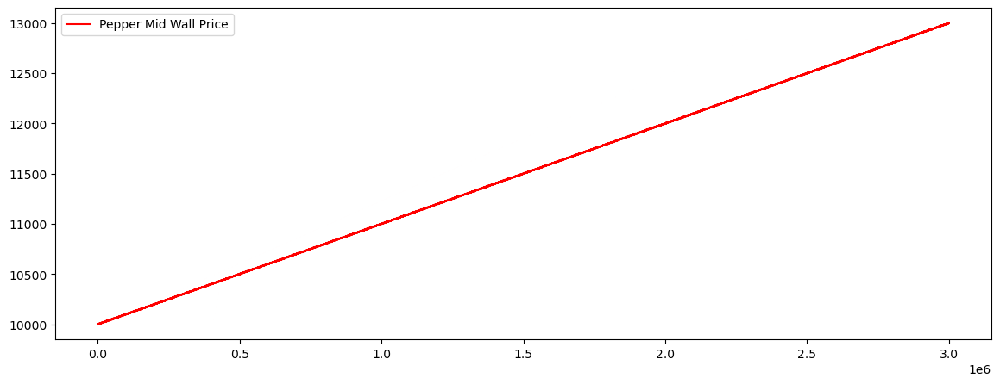
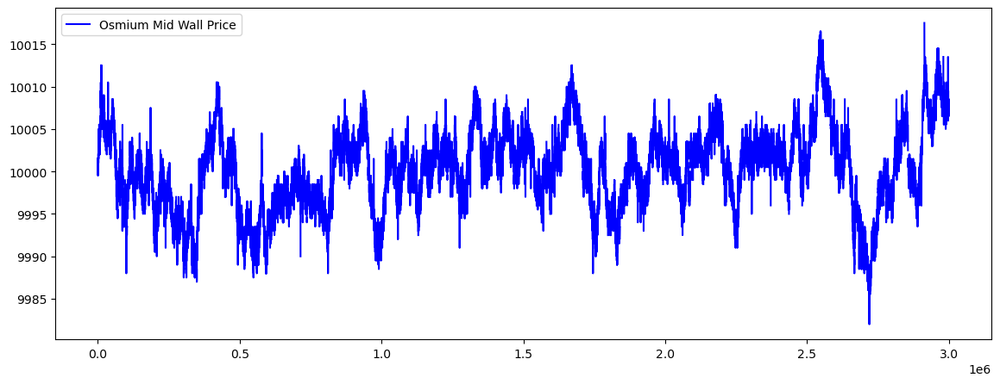

# IMC Prosperity 4 Challenge
## Team Name: AndromedaAlpha
## Final Position: 1272

This repository contains code for my submissions to the [IMC Prosperity 4](https://prosperity.imc.com/game) trading competition, organized by round.

Big thanks to IMC for organizing such a fun competition! I learned a lot about market making (and taking), order book structure, asset pricing strategies, and game theory. I look forward to coming back next year!

### Leaderboard

| Round | Overall | Algorithmic | Manual | Country (USA) |
|-|-|-|-|-|
| 1 | 562 | 735 | 1 | 158 |
| 2 | 721 | 320 | 375 | 175 |
| 3 | 543 | 448 | 669 | 167 |
| 4 | ~740 | ~587 | ~1800 | 98 |
| 5 | 1272 | 205 | 2991 | 340 |

## Round 0 (Tutorial Round)
This challenge involed EMERALDS and TOMATOES. EMERALDS followed a static price of 10000 XIRECS, while TOMATOES was more volatile. I employed a strategy of first market taking any arbitrage prices, then market making to tighten the spread and capture any profitable trades from other bots. The fair price for EMERALDS was set at exactly 10000, while the fair price for TOMATOES was determined by the mid wall price (i.e. the mid of the outermost bid/asks, that stays more constant and reduces volatility).

## Round 1


This challenge involved two products: ASH_COATED_OSMIUM and INTARIAN_PEPPER_ROOT. 

| Product | Strategy |
|-|-|
| INTARIAN_PEPPER_ROOT | buy-and-hold with optimized initial purchasing |
| ASH_COATED_OSMIUM | market taking + market making |

---
### INTARIAN_PEPPER_ROOT
INTARIAN_PEPPER_ROOT followed a stricly positive linear pattern:


Assuming this trend would continue, buying and holding would be far more profitable than trying to scalp as a market maker. I tried to find a way to do market-making while holding >80% of the position limit, but the performance was not improving. I shifted my focus to find a way to optimize the initial purchase to get the best possible price at the beginning of each trading day. I found that buying at a premium of no more than 7 (MAX_PREMIUM) at the beginning of the trading day yielded the best performance per the backtester, rather than arbitrarily taking every ask at t=0.

---
### ASH_COATED_OSMIUM
ASH_COATED_OSMIUM was noisy, and mean-reverting around a price of 10000:


Similar to the strategy for TOMATOES, I used the wall mid price to first market take, then market make, rather than trying to guess the next movement. In retrospect, I probably should've implemented some sort of inventory management system to mitigate the risk, but the core strategy worked pretty well.

## Round 2

Nothing new was introduced in round 2, and the price dynamics of both assets remained the same. The key difference was the ability for players to implement a bid() method that returns an int bid that can be used to obtain 25% more market volume. Only the top 50% of bids are accepted among all players (i.e. bids above the median).

First I considered whether I wanted the additional volume. Would the extra volume create more competition that means margins are smaller when market making? The IMC backtester suggested that more volume did increase my profitability (it randomly assigned 80-100% volume),

Realizing that most participants wouldn't bother with bidding at all, the median may very well be 0, so I settled for a bid of 1. 
```python
def bid() -> int:
    return 1
```
While I am not sure what the median ended up being, or if I even hit the median, given I jumped up to 320th place in the algorithmic category, I can say this was not a bad strategy.


## Round 3

This round introduced HYDROGEL_PACK, VELVETFRUIT_EXTRACT, and a collection of VEV voucher options. I treated the two underlying products as mean-reverting markets and used different thresholds for the voucher strikes depending on how much they moved.

| Product | Strategy |
|-|-|
| HYDROGEL_PACK | fair price estimate + mean reversion + market making |
| VELVETFRUIT_EXTRACT | fair price estimate + trade direction signal |
| VEV_4000 - VEV_5500 | anchor divergence + market making |

### HYDROGEL_PACK and VELVETFRUIT_EXTRACT

For both underlying products, I used a Kalman filter to estimate a fair price from the order book micro-price. In simple terms, the filter kept a fair price estimate from the previous tick, compared it with the latest micro-price, and moved the estimate part of the way toward the new value. This helped ignore some of the short-term noise instead of changing the fair price completely after every small movement.

The strategy then estimated volatility and used the distance from a fixed price to determine a target position. It bought or sold when prices were far enough from the estimate and also placed orders in the book to earn the spread.

VELVETFRUIT_EXTRACT also looked at the direction of larger trades. Buying trades increased my target position and selling trades decreased it. The effect faded over time, so one old trade did not influence the strategy forever.

### VEV vouchers

For the VEV strikes, I used the average mid-price so far as a reference price and traded when a voucher moved far enough away from it. The strategy bought cheap vouchers and sold expensive ones, then placed market-making orders around a fair price based on the full order book. I used different thresholds for each strike because the lower strikes moved more than the higher strikes.


## Round 4

Round 4 kept HYDROGEL_PACK, VELVETFRUIT_EXTRACT, and the VEV vouchers, but I changed the strategy after looking at the historical prices and spreads. I used price deviations from an average for most products, a more detailed mean-reversion strategy for HYDROGEL_PACK, and buy-and-hold for the vouchers that stayed close to zero.

| Product | Strategy |
|-|-|
| HYDROGEL_PACK | mean reversion + inventory-aware market making |
| VELVETFRUIT_EXTRACT and VEV_4000 - VEV_5500 | trading around a historical average |
| VEV_6000 and VEV_6500 | buy-and-hold |

### HYDROGEL_PACK

The HYDROGEL_PACK strategy compared the current price with its average and used several moving averages to check the direction of the market. When the price was far enough from its fair value and the moving averages supported a return toward that value, the strategy traded more aggressively. It also changed its order sizes depending on my current position and used position caps to manage risk.

### VEV vouchers

For VELVETFRUIT_EXTRACT and most of the VEV strikes, I used a separate average, amount of variation, trading threshold, and order size for each product. The average was allowed to update as new prices arrived, but it still kept most of the original estimate. The deep out-of-the-money VEV_6000 and VEV_6500 vouchers stayed close to zero, so rather than forcing a noisy trading signal, I bought the available asks and held the position.

## Round 5

Round 5 introduced 50 products with a position limit of only 10 per product. Since I could not take large positions, I used one general market-making framework and gave each product a small long or short bias based on its observed trend.

The market maker used the order book micro-price as its fair value and moved its quotes depending on my current position. It also used a moving average that gave more weight to recent prices to make a small mean-reversion adjustment to its target position. It bought or sold when the resting orders were attractive and placed new orders around its adjusted fair value. This allowed the same code to handle products with different spreads and trends.

The main exception was the SNACKPACK group. Analysis showed that CHOCOLATE and VANILLA, RASPBERRY and STRAWBERRY, and the PISTACHIO combinations often moved in related ways. I tracked their sums or differences with moving averages and traded when those relationships moved unusually far from normal. The strategy then bought one product and sold the other when appropriate, adding a paired mean-reversion strategy on top of the general market maker.

## Concluding Thoughts

Between the two halves of the competition, the products changed from simple single-asset markets to related underlyings, vouchers, and finally a broad collection of correlated products. In Round 0 and Round 1, I relied mainly on fixed fair values, wall prices, and straightforward market taking or making. Round 2 showed that a small strategic bid could improve the available trading volume.

In Round 3, I began storing more information between ticks with a fair price estimate, volatility estimates, reference prices, and trade direction. Round 4 refined this into product-specific mean-reversion strategies, while Round 5 generalized the code into an inventory-aware market maker with moving averages and paired trading. The overall progression was from manually chosen rules toward reusable OOP components that preserved state and adjusted their position sizes to each product. This made it easier to code since I wasn't re-writing basic functionalities for each trader.

While I struggled with some of the manual challenges in the later rounds, I am still very happy with finishing in 1272th place overall, and especially with finishing #205 in the algorithmic category! Thanks again to IMC for hosting, it was a really fun competition for me to work on, especially while I was studying abroad in Australia. See y'all next year!


## Acknowledgements
- I used an OOP approach from [Frankfurt Hedgehogs](https://github.com/TimoDiehm/imc-prosperity-3) when developing my initial `Trader` class. This was very useful and helped keep my code maintainable. Highly recommend looking at their write up from IMC Prosperity 3 as well, as it helped me understand what makes a solid strategy.
- [Jmerle's Backtester](https://github.com/jmerle/imc-prosperity-3-backtester/) and [visualizer](https://jmerle.github.io/imc-prosperity-3-visualizer/).